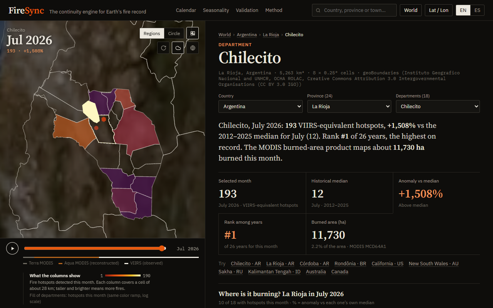
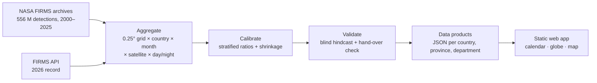

# FireSync

**The continuity engine for Earth's fire record.** One consistent, validated record of fire activity from November 2000 to today, for any country, province or department on Earth, built from 25 years of NASA MODIS and VIIRS satellite data.

[](https://firesync.space)
[](https://www.spaceappschallenge.org/)
[](https://firms.modaps.eosdis.nasa.gov)
[](LICENSE)

**[Open FireSync →](https://firesync.space)** · Demo: [Chilecito department, July 2026](https://firesync.space/#r=ARG~ARG-1302~61730980B21035116848731&t=2026-07) · [La Rioja province, July 2026](https://firesync.space/#r=ARG~ARG-1302&t=2026-07)

NASA Space Apps Challenge 2026 · Challenge: *Harmonization of MODIS and VIIRS Hot Spots* · Global Nominee after winning our local event in Argentina.



<sub>The Chilecito department in July 2026 (Spanish interface). The app also runs in English.</sub>

## The problem

MODIS has watched Earth's fires since 2000, and it is retiring. VIIRS, its successor, sees fires differently: its pixels are smaller (375 m vs 1 km) and it is far more sensitive at night, so it detects about 5 times more hotspots by day and up to 30 times more at night. Glue the two raw records together and 2012 shows a fire explosion that never happened. Fire managers lose a consistent 25-year history exactly when they need it to tell whether this month is abnormal.

## What FireSync does

- **One harmonized record.** All 556 million NASA FIRMS detections from 48 yearly global archives (MODIS 2000–2025, VIIRS Suomi NPP 2012–2025, VIIRS NOAA-20 2018–2025) plus the 2026 record from the FIRMS API, expressed in *VIIRS-equivalent hotspots*.
- **Burning activity calendar.** A year × month heatmap with a perceptually uniform color ramp (inferno), an anomaly mode with a colorblind-safe diverging ramp, and hatched cells wherever a value is reconstructed from MODIS.
- **Every region on Earth.** Drill down from the world to a country, to any of the **4,596 provinces and states** (Natural Earth admin-1) and to **49,038 departments, counties or districts** in about 180 countries (geoBoundaries). Every unit has its own precomputed calendar. A circle mode analyzes any point with an adjustable radius.
- **This month vs history.** The median of the same calendar month over a selectable baseline (excluding the year evaluated), the anomaly in percent, the rank among all years and a plain-language sentence.
- **Where is it burning?** A monthly ranking of countries or provinces, each compared with its own median, and a choropleth on the map.
- **Burned hectares.** The MODIS MCD64A1 burned-area product, read through Microsoft Planetary Computer for the selected area and month.
- **Honest uncertainty.** Reconstructed months carry a likely range, and the app has a Limitations section.
- **3D globe or 2D map**, a 25-year time-lapse, region + date-range analytics, CSV / JSON / PNG downloads, a shareable URL for every view, and an English and Spanish interface.

## Results

**Blind hindcast.** Factors fitted on 2012–2017 predict the VIIRS counts of 2018–2021 from Aqua MODIS alone, for 6,760 country-months with at least 20 hotspots. FireSync is compared with the single global factor that most approaches use.

| Metric | FireSync | Single global factor |
|---|---|---|
| Median absolute error | **22.8 %** | 35.7 % |
| Total bias | **−1.7 %** | −4.2 % |
| Correlation (log) | **0.953** | 0.951 |

**Hand-over check on untouched data.** Suomi NPP left FIRMS on 2 November 2026 and NOAA-20 now carries the record. October 2026 is the only full month with both satellites in the 2026 record, and the fit never saw it. Over 138 countries, NOAA-20 × its factor reproduces Suomi NPP with a **7.7 %** median absolute error and a **+3.8 %** total bias.

**Data audit** (`node scripts/audit_regions.mjs web/data`). 99.97 % of the 2025 hotspots fall inside the border of the country FIRMS assigns them to, and the sum of all countries matches the world series within 0.03 %.

**Case study: Chilecito, July 2026.** The fire that the challenge video features. The Chilecito department had 193 VIIRS-equivalent hotspots, **+1,508 %** over its July median of 12 and the highest July in 26 years. MODIS MCD64A1 maps about 11,730 ha burned, consistent with the 10,000–15,000 ha reported in the press.

## How it works



1. **Common filters.** Keep FIRMS `type = 0` (presumed vegetation fire), MODIS confidence ≥ 30 and VIIRS nominal or high confidence. Low-confidence VIIRS is dropped across the whole record, so the South Atlantic Anomaly filter that FIRMS applies only to near-real-time data cannot create a break. A static-source mask does the job of `type` for near-real-time data.
2. **Reference-satellite chain.** One satellite defines each month: Terra (Nov 2000–Jun 2002) → Aqua (Jul 2002–Jan 2012) → Suomi NPP (Feb 2012–Oct 2026) → NOAA-20. Satellites are never summed, so adding or losing one cannot inflate the counts.
3. **Stratified calibration.** For each country × calendar month × day/night stratum, the factor is the ratio of sums over the overlap years: Aqua vs Suomi NPP 2012–2021, Terra vs Suomi NPP 2012–2019, NOAA-20 vs Suomi NPP 2018–2025. Thin strata are shrunk toward the country factor and then the global factor (k = 30 pseudo-detections).
4. **Uncertainty.** The interquartile range of the yearly ratios in each stratum.
5. **Regions.** Country calendars are exact sums of FIRMS detections. Provinces and departments sum the 0.25° cells whose centre falls inside them.

**Limitations.** Hotspots measure fire activity, not hectares or number of fires. Months before February 2012 are reconstructed from MODIS. Provinces and departments use the factors of their country, and small units carry a border error of about one grid cell. The app lists every limitation next to the results.

## Repository layout

| Path | Content |
|---|---|
| `pipeline/FireSync.cs` | Aggregation, calibration and validation pipeline (C#) |
| `scripts/build_regions.mjs` | Joins Natural Earth borders to the record: calendars for all 4,596 provinces and states, search index, country borders |
| `scripts/build_adm2.mjs` | Nests the 49,038 geoBoundaries departments in their province and builds their calendars |
| `scripts/audit_regions.mjs` | Data audit: country attribution against Natural Earth borders, and that every level adds up |
| `scripts/handover_check.mjs` | NOAA-20 vs Suomi NPP check on October 2026 |
| `scripts/firms_zips.curlrc`, `scripts/fetch_2026.ps1` | Download of the FIRMS yearly archives and the 2026 API record |
| `scripts/serve.ps1` | Zero-install local web server for Windows |
| `web/` | Static web app (no build step) and its generated data products in `web/data/` |
| `docs/screenshots/` | Screenshots of the app |
| `research/` | Background research on the sensors, the FIRMS products and the harmonization literature (Spanish) |

## Run it locally

The app is static: it only needs the `web/` folder (about 370 MB and 9,100 files including its data) and any local web server. Opening `index.html` by double-click does not work, because browsers block `fetch` from `file://`.

| System | Command, run from the repository folder |
|---|---|
| Windows (no installs) | `powershell -ExecutionPolicy Bypass -File scripts\serve.ps1` |
| Any OS with Python 3 | `python -m http.server 8080 --directory web` |
| Any OS with Node.js | `npx serve web -l 8080` |

Then open http://localhost:8080.

## Rebuild the data

Rebuilding needs the 9 GB of raw FIRMS archives. The pipeline compiles on Windows with the built-in `csc.exe`; on macOS or Linux, use Mono (`mcs`) or the .NET SDK.

```powershell
# 1. Download the FIRMS yearly global archives 2000-2025 (~9 GB) into data/raw/zips
curl.exe -K scripts\firms_zips.curlrc -Z --parallel-max 4 --retry 5 -f --create-dirs
# 2. Download 2026 through the FIRMS API (put your free MAP_KEY in scripts\firms_key.txt; ~40 min within the key's rate limit)
powershell -ExecutionPolicy Bypass -File scripts\fetch_2026.ps1
# 3. Compile the pipeline
C:\Windows\Microsoft.NET\Framework64\v4.0.30319\csc.exe /optimize+ /platform:x64 /out:pipeline\bin\firesync.exe /r:System.IO.Compression.dll /r:System.IO.Compression.FileSystem.dll pipeline\FireSync.cs
# 4. Aggregate (about 2 minutes on 8 cores), ingest 2026 and build the products
pipeline\bin\firesync.exe aggregate data\raw\zips data\work 8
pipeline\bin\firesync.exe ingest-api data\raw\api data\raw\zips data\work
pipeline\bin\firesync.exe build data\work web\data 0.25
# 5. Regions: Natural Earth 1:50m admin-0 and 1:10m admin-1 shapefiles (naciscdn.org) unzipped into data\raw\ne
npx mapshaper -i data\raw\ne\ne_50m_admin_0_countries\ne_50m_admin_0_countries.shp -filter-fields ADM0_A3,ADMIN,NAME,NAME_ES,NAME_EN,ISO_A3,ISO_A2,LABEL_X,LABEL_Y -simplify interval=4000 keep-shapes -o precision=0.01 format=geojson data\raw\ne\world.json
npx mapshaper -i data\raw\ne\ne_10m_admin_1_states_provinces\ne_10m_admin_1_states_provinces.shp -filter-fields adm1_code,adm0_a3,admin,name,name_en,name_es,type_en,type,iso_3166_2,latitude,longitude -simplify interval=1500 keep-shapes -o precision=0.001 format=geojson data\raw\ne\adm1.json
node scripts\build_regions.mjs data\raw\ne web\data
# 6. Departments / counties: geoBoundaries gbOpen ADM2 catalog plus one simplified GeoJSON per country in data\raw\gb
curl.exe -sS -o data\raw\gb\all_adm2.json https://www.geoboundaries.org/api/current/gbOpen/ALL/ADM2/
node scripts\build_adm2.mjs data\raw\gb web\data mapshaper
# 7. Checks
node scripts\handover_check.mjs web\data
node scripts\audit_regions.mjs web\data
```

## Data sources and credits

- **NASA FIRMS** (Fire Information for Resource Management System): MODIS MCD14ML (Collection 6.1/6.2) and VIIRS 375 m Suomi NPP VNP14IMG and NOAA-20 VJ114IMG (V002) yearly archives, plus the FIRMS area API for 2026. *We acknowledge the use of data and imagery from NASA's Fire Information for Resource Management System (FIRMS) (https://earthdata.nasa.gov/firms), part of NASA's Earth Science Data and Information System (ESDIS).*
- **MODIS MCD64A1** burned area (Collection 6.1, NASA LP DAAC), accessed through the **Microsoft Planetary Computer** STAC and data APIs.
- Country, province and state borders: **Natural Earth** 1:10m admin-1 and 1:50m admin-0 (public domain).
- Departments, counties and districts: **geoBoundaries** gbOpen ADM2 (Runfola et al. 2020; licence per country, shown in the app for each unit).
- Town search: **OpenStreetMap Nominatim**, © OpenStreetMap contributors (ODbL). Queries are only sent on an explicit search.
- **NASA Blue Marble** Earth imagery, topology and water mask, as packaged in the `three-globe` examples (MIT), and the cloud texture from the `globe.gl` examples, re-encoded as WebP in `web/assets/tex`.
- Libraries: three.js (MIT), globe.gl and three-globe (MIT), Apache ECharts (Apache-2.0). Fonts: IBM Plex Sans, IBM Plex Mono and Source Serif 4 (SIL OFL).
- Main references: Giglio et al. (2016), *Remote Sensing of Environment* 178; Schroeder et al. (2014), *Remote Sensing of Environment* 143; Chen et al. (2023), GFED5, *Earth System Science Data* 15; INPE Programa Queimadas (reference-satellite approach).

FireSync is a NASA Space Apps Challenge project. It is not endorsed by NASA and uses no NASA logos or branding. Built with the help of an AI assistant (Claude, Anthropic), as declared in our Space Apps submission.

## Team

Jano, Mel, Siro, Yuri and Valen · Argentina

## License

Apache License 2.0. See [LICENSE](LICENSE).
